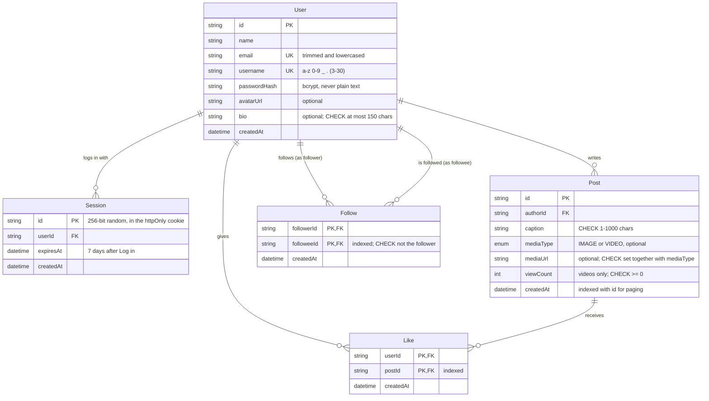

# Sociao

A small social app: people publish **Posts** (a Caption with an optional image or video), see everyone's Posts in a **Feed**, **Like** them, and **Follow** each other from their **Profiles**. It's built from the brief *AI-First Engineer: Live Build Assignment* as a mobile-sized web app with a real backend and database, test-first and one feature at a time, with every prompt kept in [PROMPTS.md](PROMPTS.md).

| Doc | What it answers |
| --- | --- |
| [CONTEXT.md](CONTEXT.md) | What we're building, and the constraints |
| [PRODUCT_REQUIREMENTS.md](PRODUCT_REQUIREMENTS.md) | Every requirement with an id and its status |
| [DECISIONS.md](DECISIONS.md) | Why each choice was made (D-001 onwards) |
| [UBIQUITOUS_LANGUAGE.md](UBIQUITOUS_LANGUAGE.md) | The words we use and what they mean |
| [PROMPTS.md](PROMPTS.md) | The full prompt history, verbatim |

---

## Running it

**You need:** Node 22+, npm 10+, and Docker Desktop (for Postgres).

```bash
npm install                                   # installs both workspaces and generates the Prisma client
cp server/.env.example server/.env            # local-only database URL and port
npm run db:up                                 # starts Postgres 17 in Docker (host port 5433)
npm run db:migrate                            # creates the tables
npm run db:seed                               # loads demo Users, Posts and Likes (resets only the demo Users, D-030)
```

Then start the API and the web app in two terminals:

```bash
npm run dev:server                            # API on http://localhost:4000
npm run dev:client                            # app on http://localhost:5173
```

Open **http://localhost:5173**. On a desktop browser the app shows as a phone-width column. Use your browser's device toolbar to see it at phone size.

> **Why port 5433?** A native Postgres often already owns 5432 on developer machines, so the container uses 5433 to avoid clashing with it (D-020).

### Demo accounts

Every seeded User has the password **`Sociao#2024`**. The email is the Username at `sociao.test`:

| Name | Email |
| ---- | ----- |
| Gustavo Levin | `gustavo.levin@sociao.test` |
| Marilyn Torff | `marilyn.torff@sociao.test` |
| Lindsey Septimus | `lindsey.septimus@sociao.test` |
| Livia Botosh | `livia.botosh@sociao.test` |
| Drake Morgan | `drake.morgan@sociao.test` |
| Randy Vetrovs | `randy.vetrovs@sociao.test` |

Log in as Gustavo to see some Posts already liked and a Profile with Followers. Seed images, avatars and videos are public stock links, so they need an internet connection (D-027, D-029).

### Tests

```bash
npm test             # server (Vitest + Supertest, against a real Postgres test database) and client (React Testing Library)
npm run typecheck
```

The server tests use a **separate `sociao_test` database**, created automatically by the Docker container. The test setup refuses to run against any other database and applies migrations first (D-020). Postgres must be running (`npm run db:up`).

---

## Stack, and why

| Layer | Choice | Why (details in DECISIONS.md) |
| ----- | ------ | --- |
| Language | TypeScript everywhere | One language across frontend, backend and tests (D-004) |
| Frontend | React 19 + Vite, React Router, CSS Modules | Light, fast setup for a phone-sized single-page app; scoped styles with nothing extra to install (D-004, D-025) |
| Backend | Node + Express 5 | Minimal, with little framework behaviour to explain (D-004) |
| Database | PostgreSQL 17 in Docker | Production-grade constraints and concurrency; nothing to install besides Docker (D-017) |
| ORM | Prisma 7 with the `pg` adapter | Readable schema, generated types, migrations, seeding (D-004, D-018, D-020) |
| Auth | Session rows plus an `httpOnly` cookie, bcrypt | Log out truly ends the Session, scripts can't read the cookie, and passwords are only stored hashed (D-005, D-021, D-023) |
| Tests | Vitest, Supertest, React Testing Library | One test runner for both sides; API tests run against real Postgres (D-004, D-008) |

---

## Schema



How it fits together:

- **A Like is a row, not a number.** Its primary key `(userId, postId)` makes the database itself reject a second Like by the same User on the same Post (FEED-06).
- **Counts are worked out, not stored.** The Feed computes `likeCount` (count the Like rows) and `likedByMe` (does a row exist for this viewer?) on every request. They can never drift out of sync, so the count is right after a refresh (FEED-05). `likedByMe` depends on who is looking, so it couldn't be a column on Post anyway (D-026).
- **A Follow is also a row,** keyed by `(followerId, followeeId)`. It's one-way, so following back is a second row. Follower, Following and Post counts are computed the same way as Likes (D-031).
- **A View count is a counter on Post**, not rows, because one person can watch a video many times (D-031).
- **`CHECK` constraints** sit in the migration SQL, because Prisma's schema language can't express them. They hold even if the API is bypassed:
  - a Caption is 1–1000 characters;
  - `mediaType` and `mediaUrl` are both set or both empty;
  - a bio is at most 150 characters;
  - `viewCount` can't be negative;
  - no one can follow themselves.
- **Deleting cascades:** deleting a User deletes their Sessions, Posts, Likes and Follows (in both directions). Deleting a Post deletes its Likes.
- **Sign up creates the User and their first Session in one transaction,** so neither exists without the other (D-011).

## API

All routes are JSON. Routes marked 🔒 need a valid Session cookie and otherwise answer `401`.

| Method and path | What it does |
| --------------- | ------------ |
| `POST /auth/signup/check` | Sign up step 1: validates Name, email and password; **stores nothing** |
| `GET /auth/username-suggestions?name=` | 3 free Usernames built from the Name |
| `POST /auth/signup` | Sign up step 2: re-checks everything, creates the User and Session, sets the cookie |
| `POST /auth/login` | Same `401 "Incorrect email or password"` for every failure, with equal timing |
| `POST /auth/logout` | Ends this Session only and clears the cookie |
| `GET /auth/me` 🔒 | The logged-in User |
| `GET /feed?cursor=` 🔒 | Posts newest first, 10 per page, with `nextCursor` |
| `PUT /posts/:id/like` 🔒 | Like (repeating it changes nothing) → `{ likeCount, likedByMe }` |
| `DELETE /posts/:id/like` 🔒 | Unlike (repeating it changes nothing) → `{ likeCount, likedByMe }` |
| `GET /users/:username` 🔒 | Profile, the three counts, `followedByMe` and `isMe` |
| `GET /users/:username/posts?type=all\|video&cursor=` 🔒 | A User's Posts or videos, the same shape and paging as the Feed |
| `PUT /users/:username/follow` 🔒 | Follow (repeating it changes nothing; following yourself gets 400) → `{ counts, followedByMe }` |
| `DELETE /users/:username/follow` 🔒 | Unfollow (repeating it changes nothing) → `{ counts, followedByMe }` |

---

## What's done and what isn't

Status per requirement id is in [PRODUCT_REQUIREMENTS.md](PRODUCT_REQUIREMENTS.md).

**Done: all four must-haves**

- **Auth** (screens 1 and 2):
  - Two-step sign up (Create Account, then Choose Username with 3 suggestions), log in and log out.
  - Password rules, with only a hash stored.
  - Logged-out Users can't reach the Feed.
  - Login button disabled until both fields are valid, show/hide password, clear error messages.
- **Database:** Postgres with the schema above, migrations and check constraints.
- **Seed data:** 6 Users, 12 Posts (text, image and video) and 28 Likes, in one command that can be re-run.
- **Home Feed** (screen 3):
  - Posts come from the API in pages.
  - Like and unlike update instantly, are saved, survive a refresh, and can't be doubled.
  - Loading, empty and error states.

**Done: the should-haves**

- **Profile** (screens 7 and 8):
  - Your own Profile at `/profile`, and anyone's at `/u/:username` (tap an Author in the Feed).
  - Name, Username, bio, and real Following / Followers / Posts counts.
  - Follow / Unfollow updates instantly and rolls back if it fails.
  - Post tab with Likes; Video tab as a two-column grid with View counts; Tag tab as an empty state.
- **Loading, empty and error states** on every screen built so far.
- **Bottom navigation** (Home and Profile work; Video, + and Inbox are disabled until built).

**Not done yet**

- **Feed details:** Save/bookmark, the Post "…" menu, the Stories row, Notifications and Messages. Comment, Share, Save and "…" are shown disabled rather than faked.
- **Bonus screens 4–6 and 9–13:**
  - Video viewer, Comments sheet, Messages inbox and Chat thread.
  - Edit Profile and Settings.
  - Followers and Following lists, and Create Post behind the + button.
- **View counting:** the counts are seed data until the Video viewer records views.
- **Temporary Log out:** it's an icon in the Feed header until Settings exists.

**Deviations from the mockups** (the brief asks us to decide and say so):

- **Username field:** Create Account has no Username field in the mockup. We added a second step, *Choose Username*, and the User is only created when it's finished (D-007, D-011).
- **Log in screen:** its password field is labelled "Password", not "Create Password", and the sign-up link reads "Create Account", not "Sign in" (D-025).
- **Step 1 button:** it says "Continue", because nothing is created yet (D-025).

---

## What the AI got wrong, and how it was caught

_To be finalised by the developer before submitting (DEL-04). Candidates so far:_

- **Prisma version:** `npm install prisma` pulled a release candidate (`8.0.0-rc`) that didn't match the 7.x client. We caught it reading the installed versions after setup and pinned stable 7.x (D-018).
- **Seed videos:** the seed used Google's public sample-video bucket, which now answers `403`, so every video Post was blank. We caught it during the browser check (media error 4, then `curl` showed the 403) and switched sources (D-029).
